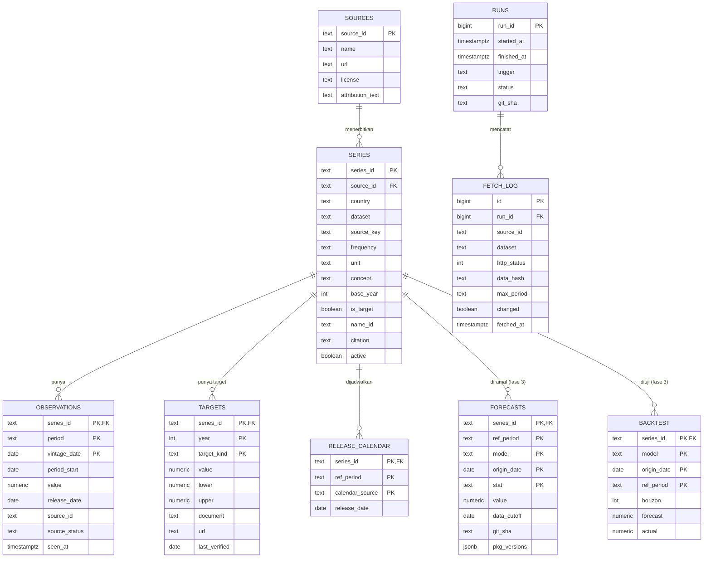
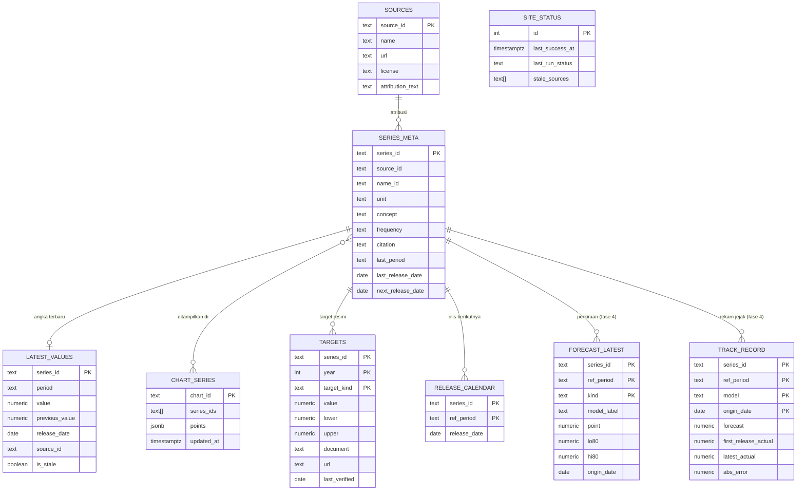

Status: plan (disetujui pengelola 2026-10-30, sebelum ada migrasi; ditulis ulang dari migrasi begitu ada)

# Skema Database Con-Fore

Database Supabase Postgres (paket Free) dengan dua skema:

| Skema | Isi | Terbuka ke Data API |
|---|---|---|
| `etl` | Data kerja pipeline: registri seri dan sumber, observasi dengan vintage, log, forecast | Tidak |
| `public` | Tabel siap tampil yang dibangun ulang setiap publikasi | Ya, hanya SELECT untuk peran `anon` |

Yang menulis hanya pipeline (peran `postgres` lewat session pooler). Situs hanya membaca `public` lewat server Vercel. Alur datanya ada di [ARCHITECTURE.md](ARCHITECTURE.md). Semua SQL pipeline memakai nama berskema (`etl.x`, `public.x`), karena beberapa nama tabel ada di kedua skema.

## 1. ERD

### 1.1 Skema `etl`

Relasi di skema ini dideklarasikan sebagai foreign key.



`etl.schema_migrations` (versi dan waktu terap) berdiri sendiri, tanpa relasi.

### 1.2 Skema `public`

Semua tabel `public` diturunkan dari `etl` dan dihubungkan lewat `series_id`. Relasinya **logis saja, tidak dideklarasikan sebagai foreign key**, karena seluruh skema diisi ulang dalam satu transaksi.



## 2. Tabel dan constraint

### 2.1 Skema `etl`

| Tabel | Kunci | Constraint dan catatan |
|---|---|---|
| `sources` | `source_id` | Nama, URL, lisensi, dan kalimat atribusi wajib per sumber (misalnya atribusi BPS). Dimuat dari `config/sources.csv`. |
| `series` | `series_id` | FK `source_id`. `frequency` in (`A`,`Q`,`M`,`D`). `concept` in (`level`,`index`,`yoy`,`avg_yoy`,`eop_yoy`,`rate`,`round_rate`), supaya hanya konsep yang sama yang dibandingkan (contoh: sasaran inflasi dengan `eop_yoy`). `country` default `IDN`. Dimuat dari `config/series.yaml`. |
| `observations` | (`series_id`, `period`, `vintage_date`) | `period` berformat `YYYY`, `YYYY-Qn`, `YYYY-MM`, atau `YYYY-MM-DD`; `period_start` (date, not null) untuk pengurutan. `vintage_date` = tanggal WIB saat nilai pertama kali terlihat. `source_id` mencatat asal nilai (BPS, IMF, manual) agar rekam jejak hanya dinilai terhadap rilis pertama BPS. |
| `targets` | (`series_id`, `year`, `target_kind`) | `target_kind` in (`apbn`,`pmk`,`rpjmn`): lensa target memakai APBN (pertumbuhan, TPT) dan PMK (inflasi); panel jangka panjang memakai RPJMN. `value` dengan `lower`/`upper` untuk rentang. `document`, `url`, `last_verified` wajib diisi. Dimuat dari `config/targets.csv`. |
| `release_calendar` | (`series_id`, `ref_period`, `calendar_source`) | `calendar_source` misalnya kalender BPS, kalender IMF DSBB, jadwal RDG BI. Dimuat dari `config/release_calendar.csv`. |
| `forecasts` (fase 3) | (`series_id`, `ref_period`, `model`, `origin_date`, `stat`) | `stat` in (`point`,`lo80`,`hi80`,`lo95`,`hi95`). Hanya ditambah, tidak pernah ditimpa. `git_sha` dan `pkg_versions` mencatat kode dan versi paket yang menghasilkannya. |
| `backtest` (fase 3) | (`series_id`, `model`, `origin_date`, `ref_period`) | `horizon` dalam satuan periode seri. Sumber lebar rentang ketidakpastian. |
| `runs` | `run_id` (identity) | `trigger` in (`schedule`,`release`,`push`,`dispatch`,`laptop`); `status` in (`running`,`ok`,`partial`,`failed`). |
| `fetch_log` | `id` (identity) | FK `run_id`. Tidak pernah menyimpan URL (key BPS ada di path URL). `data_hash` adalah hash data ternormalisasi (seri, periode, nilai). |
| `schema_migrations` | `version` | Diisi oleh `python -m confore migrate`. |

`config/holidays.csv` dibaca langsung oleh model dan tidak disimpan di database, karena berkasnya sudah ada di repo.

### 2.2 Skema `public`

| Tabel | Kunci | Catatan |
|---|---|---|
| `sources` | `source_id` | Untuk halaman Sumber data, termasuk kalimat atribusi wajib |
| `series_meta` | `series_id` | Nama Indonesia, satuan, sumber, sitasi, periode terakhir, tanggal rilis terakhir dan berikutnya |
| `latest_values` | `series_id` | Angka terbaru per seri beserta angka sebelumnya, untuk kartu dan kalimat ringkasan |
| `chart_series` | `chart_id` | Satu baris per grafik. Satu grafik bisa memuat beberapa seri (`series_ids`), dan `points` berupa objek JSON berisi array `[periode, nilai]` per seri. Dipilih karena Data API memotong jawaban di 1.000 baris secara diam-diam. Juga sumber unduhan CSV |
| `targets` | (`series_id`, `year`, `target_kind`) | Salinan target resmi yang boleh tampil |
| `release_calendar` | (`series_id`, `ref_period`) | Hanya rilis yang akan datang |
| `site_status` | `id` (check `id = 1`) | Satu baris: `last_success_at`, status run terakhir, dan kode sumber yang terlambat. Hanya kode tetap, bukan teks bebas |
| `forecast_latest` (fase 4) | (`series_id`, `ref_period`, `kind`) | `kind` in (`con-fore`,`baseline`,`imf-weo`); yang tampil sebagai angka utama ditandai dari hasil backtest |
| `track_record` (fase 4) | (`series_id`, `ref_period`, `model`, `origin_date`) | Perkiraan dibanding rilis pertama dan angka terbaru |

## 3. Penulisan dan idempotensi

**Observasi.** Data baru di-`COPY` ke tabel sementara `tmp_obs`, lalu ditulis dengan satu perintah. Baris baru hanya masuk bila nilainya berbeda dari vintage terakhir, sehingga menjalankan ulang di hari mana pun tidak menambah salinan:

```sql
insert into etl.observations (series_id, period, vintage_date, period_start, value,
                              release_date, source_id, source_status, seen_at)
select s.series_id, s.period, s.vintage_date, s.period_start, s.value,
       s.release_date, s.source_id, s.source_status, now()
from tmp_obs s
left join lateral (
  select o.value from etl.observations o
  where o.series_id = s.series_id and o.period = s.period
  order by o.vintage_date desc
  limit 1
) last on true
where last.value is distinct from s.value
on conflict (series_id, period, vintage_date) do update
  set value = excluded.value, seen_at = now()
  where etl.observations.value is distinct from excluded.value;
```

Koreksi di hari yang sama menimpa nilai hari itu. Bila koreksinya mengembalikan nilai ke vintage sebelumnya, baris hari itu dihapus supaya tidak ada vintage kembar.

**Publikasi.** Semua tabel `public` diisi ulang dalam **satu transaksi** dengan `DELETE` lalu `INSERT`. Jangan pernah `DROP TABLE`, `CREATE TABLE AS`, atau `to_sql(if_exists='replace')`, karena cara itu membuat tabel baru tanpa GRANT, kebijakan, dan RLS.

**Ganti tahun dasar.** Buat `series_id` baru dengan `base_year` sendiri; seri lama dibekukan (`active = false`).

**Backup.** Ekspor mingguan dibaca dalam satu transaksi `REPEATABLE READ` (atau `pg_dump`), supaya semua tabel berasal dari snapshot yang sama.

## 4. Kebijakan akses

| Peran | Dipakai oleh | Hak |
|---|---|---|
| `postgres` | Pipeline lewat session pooler | Penuh atas `etl` dan `public` |
| `anon` | Server Vercel (publishable key) | Hanya SELECT pada tabel `public` |
| `authenticated` | Tidak dipakai (tidak ada login) | Tidak ada |
| `service_role` / secret key | Tidak dipakai di MVP | Tidak ada |

Migrasi awal (`0001`) menutup akses bawaan. Pernyataan global terakhir berlaku untuk semua skema, termasuk `etl`; itu aman karena pipeline berjalan sebagai pemilik (`postgres`) dan kebijakan RLS tidak memakai fungsi bantu.

```sql
create schema if not exists etl;
revoke all on schema etl from anon, authenticated;

alter default privileges for role postgres in schema public
  revoke select, insert, update, delete on tables from anon, authenticated, service_role;
alter default privileges for role postgres in schema public
  revoke usage, select on sequences from anon, authenticated, service_role;
alter default privileges for role postgres in schema public
  revoke all on functions from anon, authenticated, service_role;
alter default privileges for role postgres
  revoke execute on functions from public;
```

Pola untuk **setiap** tabel `public` (contoh `latest_values`). Perintah `revoke` ditulis eksplisit supaya hasilnya sama, apa pun tanggal tabel itu dibuat terhadap perubahan Data API Supabase 2026-10-30:

```sql
revoke all on table public.latest_values from anon, authenticated;
grant select on table public.latest_values to anon;
alter table public.latest_values enable row level security;
create policy "baca publik" on public.latest_values
  for select to anon using (true);
```

Aturan tambahan:

- Fungsi bantu dibuat di skema `etl`, tidak di `public`, supaya tidak bisa dipanggil lewat `/rest/v1/rpc`.
- Tidak ada view di `public`, kecuali ditulis persis `with (security_invoker = true)`.

**Pemeriksaan sebelum setiap run menulis.** Kedua query harus mengembalikan 0 baris; kalau tidak, run berhenti.

```sql
-- tabel, view, dan materialized view di public yang aksesnya salah
select c.relname, c.relkind
from pg_class c join pg_namespace n on n.oid = c.relnamespace
where n.nspname = 'public' and c.relkind in ('r','p','v','m','f')
  and ((c.relkind in ('r','p') and not c.relrowsecurity)
    or not has_table_privilege('anon', c.oid, 'SELECT')
    or has_table_privilege('anon', c.oid, 'INSERT,UPDATE,DELETE,TRUNCATE,REFERENCES,TRIGGER')
    or has_any_column_privilege('anon', c.oid, 'INSERT,UPDATE,REFERENCES')
    or has_table_privilege('authenticated', c.oid, 'SELECT,INSERT,UPDATE,DELETE,TRUNCATE,REFERENCES,TRIGGER')
    or (c.relkind in ('r','p') and not exists (
          select 1 from pg_policies p
          where p.schemaname = n.nspname and p.tablename = c.relname
            and p.cmd in ('SELECT','ALL') and p.permissive = 'PERMISSIVE'
            and p.roles && array['anon','public']::name[]))
    or c.relkind in ('m','f')
    or (c.relkind = 'v'
        and not coalesce(c.reloptions @> array['security_invoker=true'], false)));

-- fungsi di public yang bisa dipanggil anon
select p.proname
from pg_proc p join pg_namespace n on n.oid = p.pronamespace
where n.nspname = 'public' and has_function_privilege('anon', p.oid, 'EXECUTE');
```

Pada Postgres 17, `MAINTAIN` ditambahkan ke kedua daftar hak tabel.

**Setelah setiap migrasi**, pipeline (mode `migrate`) menguji dengan publishable key: SELECT pada `public.*` berhasil; INSERT gagal; memanggil RPC gagal; tabel `etl` tidak terlihat.

## 5. Migrasi

- Letak: `supabase/migrations/NNNN_nama.sql`, berurutan dan tidak pernah diubah setelah diterapkan.
- Diterapkan oleh `python -m confore migrate` (lokal atau workflow dengan mode `migrate`), yang mencatat versinya di `etl.schema_migrations`.
- Urutan awal yang direncanakan: `0001` skema dan penutupan akses bawaan; `0002` tabel `etl`; `0003` tabel `public` beserta GRANT, RLS, dan kebijakan; fase 3 dan 4 menambah tabel forecast.

## 6. Ukuran

- Batas paket Free: 500 MB. Pipeline memberi peringatan di 300 MB.
- Perkiraan kasar (belum diukur): puluhan seri dikali ratusan periode dikali beberapa vintage, jadi masih di bawah ratusan ribu baris dan beberapa MB.
- Berkas mentah dari sumber tidak disimpan di database.
